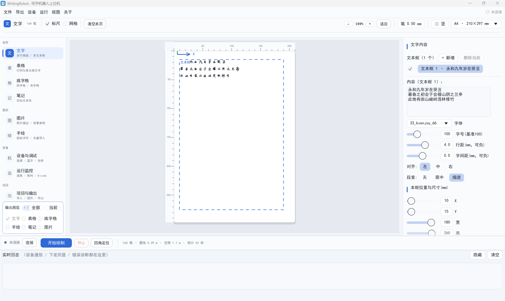

# WritingRobot

基于 Rust + egui 的写字机器人 / 笔式绘图机上位机。把文字、表格、练字格、手绘和照片线稿排成一页笔迹，生成 GRBL / Marlin / EBB 固件的 G-code，并通过串口、蓝牙、TCP 或模拟器直接驱动机器。



> 左侧模块导航（含「输出图层」）/ 中间画布 / 右侧参数栏三栏布局；底栏实时显示笔迹数、墨线长度、空移与预计耗时。点「开始绘制」先进入绘制前计算，不会实时重算 G-code。


## 核心功能

- **创作排版**：多文本框、表格、田字格 / 米字格 / 回宫格、鼠标手绘、自由笔记块；支持多模块叠加到同一页。
- **图片转线稿**：8 种绘制方式，支持裁剪、缩放、旋转、反相、扫描角度与路径排序；「素描笔触」有「随形短笔触」与「交叉排线基底」两种风格，大图默认按长边 3600px 进入算法。
- **导入前确认尺寸与精细度**：选好文件后先弹出确认窗，成品高度可选 100/150/200/250/300mm 或「适应纸面」，精细度可选原图 / 3600 / 3000 / 2400 / 1800px，并显示实际处理像素与幅面溢出提示，不再把大图静默压缩。
- **多笔分层（换笔绘制）**：把明暗带分给 HB/2B/4B/8B 或 0.25–1.0mm 针管笔，线宽与深浅由笔本身决定，不再逼一支笔靠密度硬撑。素描笔触与交叉排线都支持按明暗分层；每支笔独立生成 G-code、逐支提示换笔，可设套准偏移，导出时同时生成合并版和分笔 `.nc` 文件。
- **绘制前计算与路径优化**：改内容只重建预览，点「开始绘制」才在后台算方案，给出代码量、墨线/空移长度与预计耗时；可选保持原序 / 蛇形扫描 / 最近邻 / 同向聚类 / 分区最近邻，排序只减少笔间空移，不改变墨线总长。
- **大纸张分页**：图片超出单页幅面时按 200×280mm 自动切块、逐页绘制，换纸后按四角标记拼接；画布底部提供分页缩略图，可直接选择打印第几页；设备页也可单独绘制 1cm 四角 L 定位标记。
- **矢量导入**：DXF / SVG 导入为可绘制笔迹，PDF 按页导入。
- **字体**：加载 `.gfont` 笔画字库；字号、行距、字间距、对齐、段首均可调，带手写随机抖动。
- **设备连接**：有线串口 / 蓝牙串口 / TCP / 模拟器；后台自动扫描端口、自动波特率、固件查询、断线重连与保活心跳。
- **机器控制**：解锁、回零、点动、抬落笔、测试方框、自定义起止 G-code、激光模式（M3/M5）。
- **运行保障**：绘制前幅面边界检查、流控等待 `ok`、单步下发、实时进度 / 耗时 / 剩余时间。
- **输出**：G-code（`.nc`）、SVG、PDF、PNG，以及可重新打开的工程文件（`.wprj` / `.json`）。

## 效果图

下面两张都是程序真实生成的笔迹：左为原稿，右为按默认导入参数重画的结果。输入 1728×2304，成品高 240mm，无头渲染（未经过任何手工修饰）。

**随形短笔触（默认风格）**


**交叉排线基底（可选风格，线条更规整、耗时更短）**


## 图片线稿的 8 种方式

| 模式 | 效果 | 适用素材 |
| --- | --- | --- |
| 线框（边缘影线） | 沿边缘铺影线 | 线条清晰的照片、扫描稿 |
| 素描（影线） | 按明暗阈值逐行铺影线 | 通用照片、最经典的效果 |
| 高效（连续笔画） | 影线串成长笔画，抬落笔最少 | 追求速度的大面积图 |
| 中心线（骨架） | 细化成单像素骨架再描线 | 线稿、logo、硬笔字 |
| 描边（等值轮廓） | 只画明暗交界的轮廓 | 简笔画、卡通图 |
| 交叉排线（明暗） | 主方向打底，暗部叠垂直排线；可勾选按明暗多笔分层 | 需要层次感的素描 |
| 网点（半调） | 按灰度生成大小不一的网点 | 照片、版画风格 |
| 素描笔触（融合布线） | 默认随形体方向落 1~8mm 短笔触、逐遍补残留墨；可切交叉排线基底 | 照片肖像、静物、放大看细节的素材 |

## 素描笔触的两种风格

两种风格共用调子场、细节层与笔组参数，只是落笔流水线不同：

- **随形短笔触（默认）**：逐遍量出「目标墨 − 当前墨」的缺口，只在缺口处落 1~8mm 短直线；方向由局部轮廓 / 墨脊场给出（跟随轮廓 / 跟随原稿笔触 / 混合 / 交叉明暗调子）。多遍按交叉角叠层，最后单独一趟细节层描出发丝、眼线、唇缝，放大后仍有手绘的密集质感。
- **交叉排线基底**：全图只用「基准角 / 基准角 + 90°」两族平行线，按明暗叠 HB→8B 四档笔；每层按该笔的明暗带反解覆盖率，逐行落笔。线条更规整、耗时更短，但方向不随形体。

「走向参考」里的 **交叉明暗调子** 不看原稿内容，按遍数固定轮换 0° / 90° / 45° / 135° 等方向：浅调保持单向，越暗越叠成交叉网，适合原稿本身走向单一、想要更多层次的素材。

两档风格各带默认笔组：随形短笔触 HB 0.28 / 2B 0.38 / 4B 0.46 / 8B 0.56（深度 45 / 65 / 82 / 95%）；交叉排线 HB 0.20 / 2B 0.26 / 4B 0.32 / 8B 0.40（深度 30 / 50 / 72 / 90%）。切换风格时，只有笔组仍是旧风格默认值才跟着换，手调过的笔组保留。

笔只有一种墨色，明暗全靠线的疏密和笔的深浅表现，不能靠「描得重」——那只会沿同一轨迹反复摩擦。放大到 5 倍以上，暗部应是清楚的网口而不是糊成一片。

## 多笔分层（换笔绘制）

笔的粗细和深浅首先是物理属性：0.25mm 针管笔适合浅灰细节，1.0mm 8B 才压得住黑场。与其让一支笔靠密度硬撑整个灰阶，不如把明暗分给几支真实的笔。

1. 图片页选「素描笔触（融合布线）」或「交叉排线」，勾选「按明暗多笔分层」。
2. 在「多笔分层 · 笔组」里选铅笔组或针管笔组，按亮 → 暗排列。每支笔可改线宽（0.15~1.6mm）、满覆盖深度、颜色和启用状态，最多 4 支；文字、边框、四角标记由「主笔」画。
3. 画布预览按每支笔的真实颜色和线宽显示。明暗带边界按各笔的深度累计分配：HB 只铺浅灰到中灰，8B 负责最后的黑场；细节层再按原稿墨量分给 HB/2B/4B，深线自然落到深笔上。
4. 点「开始绘制」后先在计算窗口确认代码量与耗时，再逐支提示换笔：确认机器停稳、装入对应笔，再点「开始这支笔」。每支笔的 G-code 独立以当前位置为零点（开头 `G92 X0 Y0`、结尾 `G0 X0 Y0`），换笔不会累积坐标漂移；上一支没停稳不会提示下一支。
5. 换笔后落点有系统性偏差时，填该笔的 X/Y 套准偏移（±5mm），这一层整体平移；分页裁剪前会先补偏移，贴边笔迹不会被裁掉。
6. 导出 G-code 会同时写合并版和 `xxx-pen1-HB_0_28.nc` 这类分笔文件；也可以只跑分笔文件，逐支换笔。

> 笔组里的「深度」是这支笔满覆盖时能压出的最暗值，不是装饰参数：它决定明暗带的分界。换真实笔种后按手感微调；深度填得过高，浅笔会侵占深笔的暗部。

## 界面与操作

- **三栏布局**：左侧模块导航（含「输出图层」）、中间画布、右侧当前模块参数。「视图」菜单可单独显示/隐藏左右侧栏，`Ctrl + \` 一键同时切换，隐藏后画布占满窗口。
- **预览笔宽**：顶部「笔 0.50 mm」是预览用的真实笔尖粗细，不写入 G-code；填对后屏幕与纸上看到的一样重。填得太细，预览会把粗笔看成细笔，误以为排线太稀。
- **画布视角**：`Ctrl + 滚轮`缩放（以光标为锚点），中键拖动或 `空格 + 左键`平移，普通滚轮缩放当前选中的图片或文本框。
- **四角定位**：机器原点 (0,0) 就是纸面的左下角，定位框贴在那一侧；原点那一角的 L 臂长加倍并多一道 45° 斜线，画完一眼就能确认方向。若「项目与输出 → 坐标系与幅面」显示的「0,0 实际落在纸面…」不是左下，点「设为左下原点」——那个读数已经把「原点角」和「反转 X/Y」的叠加算进去了，别看单项。
- **状态栏**：底部实时显示「笔迹 · 墨线 · 空移 · 预计耗时」；点「开始绘制」后，以绘制前计算窗口按实际 G-code 逐行算出的值为准。

## 验证与调参（无头）

- **素描效果与指标**：`cargo test -p wrobot-gui dump_sketch_preview -- --ignored --nocapture` 会把 `tools/sketch_input.png` 重画成 `tools/sketch_verify.png`（左右对照），并打印召回率、落笔压墨率、直线度、方向差、明暗比、调子相关 r 与物理墨量（覆盖并集）。
  - 换输入：`SKETCH_IN=portrait_input.png`（相对工作区根或 `tools/`）。
  - 调参：`SKETCH_STYLE=0|1`（0 交叉排线 / 1 随形短笔触，默认 1）、`SKETCH_H`（成品高 mm，默认 240）、`SKETCH_LEVELS`、`SKETCH_THR`、`SKETCH_JIT`、`SKETCH_LEN`、`SKETCH_PENS="0.28:0.45,..."`。
  - 看局部：`SKETCH_ONLY=hatch|detail` 只画排线/只画细节，`SKETCH_BOX=x0,y0,x1,y1` + `SKETCH_ZOOM` 放大，`SKETCH_MODE=field|ftone` 输出方向场和内部调子图。
- **多笔分带**：`SKETCH_MULTI=1 SKETCH_DRAW=10 cargo test -p wrobot-gui dump_sketch_preview -- --ignored --nocapture`，会打印每支笔的笔迹数/墨量，并输出 `tools/sketch_multi_verify.png`。
- 无头工具直接取 `state::default_import_opts`，与程序导入用的是同一套默认值。
- **性能**：中心线 / 描边对大图会先降到长边 1600px（骨架细化是迭代算法，也避免界面卡死）；素描笔触保留到长边 3600px，1728×2304 的肖像在无头环境下约 20~30 秒；网点模式最多生成约 8000 个点。

## 快速开始

### 使用发布版

1. 解压 `out/WritingRobot-v0.27.0-win64.zip`（或直接运行 `out/` 里的 exe），启动 `wrobot-gui.exe`。
2. 把 `.gfont` 字库放进下列任一目录（启动时自动扫描）：
   - 程序目录下的 `gcodeFonts/`
   - `../奎享雕刻/gcodeFonts/`
   - `D:\WritingRobot\奎享雕刻\gcodeFonts`
   - `D:\WritingRobot\wrobot\gcodeFonts`
3. 打开「设备与调试」→ 扫描串口 → 选择端口 → 连接；没有机器时连接方式选「模拟」。
4. 在「创作 / 图形」里编辑内容，用左侧导航顶部的「输出图层」决定哪些模块写入 G-code（默认只输出当前页，可勾选叠加）。
5. 导入图片时会先弹出确认窗：成品高度默认「适应纸面」（200×300mm 纸上约 240mm），精细度默认长边 3600px；窗口里能看到实际处理像素和幅面溢出提示。素描笔触默认用「随形短笔触」风格与 0.28~0.56mm 笔组。
6. 点「开始绘制」，程序会先弹出「绘制前计算」：在后台排序路径、生成 G-code，并给出代码量与预计耗时；可临时改选路径优化方式，确认后再下发。
7. 画超过单页幅面的大图：在「图片」页勾选「启用分页」，画布底部会显示每页缩略图（可横向滚动），用底部页码下拉框选择要画第几页；每页画完自动回原点，换纸后继续，最后按四角 1cm L 标记对齐拼接。

### 从源码构建

需要 Rust 工具链（stable）与 Windows 10/11。嵌入 exe 图标和版本信息需要 Windows SDK 的 `rc.exe`（安装 Visual Studio Build Tools 时勾选「Windows SDK」即可）。

```bash
# 开发运行
cargo run -p wrobot-gui

# 发布构建
cargo build --release

# 运行测试
cargo test --workspace
```

产物位置：

- `target/release/wrobot-gui.exe`：图形界面（无控制台窗口，已嵌入图标与版本信息）
- `target/release/wrobot-cli.exe`：命令行工具

发布构建脚本会把 `crates/wrobot-gui/resources.rc` 中的图标与 VERSIONINFO 编译进 exe；修改 `crates/wrobot-gui/assets/icon.ico` 或版本号后重新构建即可。

GUI 启动参数：

```bash
wrobot-gui --port COM3 --baud 115200   # 启动即连接指定端口
wrobot-gui --auto                      # 启动自动搜索并连接
wrobot-gui --no-connect                # 只开界面：不扫描串口、不自动连接（调试/看界面用）
```

## 命令行工具

```text
wrobot-cli info  <工程.json>
wrobot-cli gcode <工程.json> [-o out.nc] [--firmware grbl|marlin|ebb] [--fonts <目录>]
wrobot-cli svg   <工程.json> [-o out.svg] [--fonts <目录>]
wrobot-cli png   [-o out.png] [--fonts <目录>]
wrobot-cli font  <字体.gfont> [字符...]
wrobot-cli config <default.properties>
wrobot-cli dxf   <文件.dxf> [-o out.nc] [--svg out.svg] [--firmware grbl|marlin|ebb] [--target-h 120]
wrobot-cli svgi  <文件.svg> [-o out.nc] [--svg out.svg] [--firmware grbl|marlin|ebb] [--target-h 120]
wrobot-cli ports
wrobot-cli wiretest [端口] [--baud 115200] [--loop]
wrobot-cli probe [端口] [--baud 115200]
```

- `ports`：列出本机串口，并区分【蓝牙】与【串口线】。
- `probe`：不指定端口时扫描 `COM1..COM32`，根据固件横幅或 `$I` / `M115` 响应判断是否有写字机固件。
- `wiretest`：有线串口逐层体检；`--loop` 需先短接该口 TX/RX。
- `dxf` / `svgi`：导入矢量文件并直接生成 G-code 或 SVG。

## 工程与输出

- 工程保存为 `.wprj` 或 `.json`，记录各模块内容、图片参数、设备与固件设置。
- 导出格式：G-code（`.nc`）、SVG、PDF、PNG。
- 固件：GRBL（Z 轴抬落笔）、Marlin（Z 轴或舵机）、EBB（`SP` / `SM` 指令）。
- 页面网格默认关闭；勾选「网格」后显示可调列/行（默认 10×14）的浅色虚线网格，仅作定位参考，不会写入 G-code。

## 快捷键

| 快捷键 | 功能 |
| --- | --- |
| `Ctrl + S` | 保存工程 |
| `Ctrl + O` | 打开工程 |
| `Ctrl + E` | 导出 G-code |
| `Ctrl + \` | 隐藏 / 显示左右侧栏（也可用「视图」菜单单独切换） |
| `Ctrl + 滚轮` | 缩放画布 |
| 中键拖动 / `空格 + 左键` | 平移画布 |
| `F1` | 打开快速上手 |

## 项目结构

```text
crates/
  wrobot-core/   排版、字体、G-code、SVG/PDF、串口/蓝牙、DXF/SVG/PDF 导入
  wrobot-gui/    egui 界面、画布预览、图片线稿、设备控制
  wrobot-cli/    批处理与设备诊断命令行
docs/            界面与效果图
tools/           图标 / 样例图生成脚本，以及无头出图验收的输入输出
```

## 版本

当前版本 **0.27.0**。完整的升版说明见 [CHANGELOG.md](CHANGELOG.md)。
